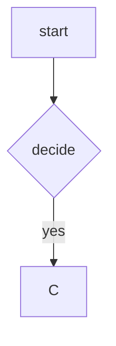

Inline math $x^2 + y^2 = z^2$ and a price of $5.

```math
E = mc^2 \quad a < b && c > d
```

```latex
\frac{1}{2}
```

```TeX
\sum_{i=0}^n i
```



$$
\int_0^1 x\,dx
$$

```mermaidx
not a diagram
```
